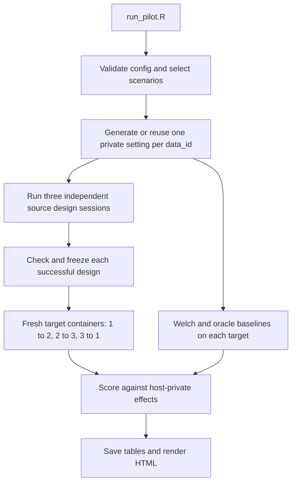

# Developer walkthrough

This guide explains how the implementation works and how to review or extend it.
Read [the contracts](agent-api.md) when changing an interface and
[configuration](configuration.md) before running a command.

The current default adds pooled leave-one-study-out algorithm selection and
study-count recovery. Read [the extension guide](pooled-selection.md) alongside
this walkthrough. The freeze, isolation and source-session interfaces below are
unchanged; cyclic transfer is retained as the `agent_cycle` comparator.

## Start at the two entry points

[`scripts/run_pilot.R`](../scripts/run_pilot.R) is the experiment entry point. It
loads [`R/bootstrap.R`](../R/bootstrap.R), reads YAML, constructs an options list,
and calls `run_pilot()`. The bootstrap resolves the project root, adds the local
R library, and sources modules; it does not run an experiment by itself.

[`agents/session.py`](../agents/session.py) is the single-agent entry point. R
launches it through `poetry run python -m agents.session --session FILE`. It does
not select target groups or score discoveries. Its job ends after validating and
freezing one source agent's artifacts.



Sessions currently execute sequentially. Independence means separate data,
histories, dependencies, workspaces, and target evaluation, not concurrent scheduling.
`scenario_designs()` finishes all three session attempts before `run_scenario()`
evaluates any targets. A failed design stays failed; it does not prevent the other
successful designs from being evaluated.

## The objects crossing each boundary

| Object | Shape and meaning | Ownership |
|:---|:---|:---|
| `config` | Validated nested list from `config/pilot.yml`. | Trusted R controller. |
| `scenario` | One row with `m`, `c`, `criterion`, `id`, `data_id`. | Trusted controller; only dimensions/criterion/allocated level go to the model. |
| `setting` | States, effects, planning, observations, RNG streams, `m`, target. | Host-private; never serialized wholesale into an agent session. |
| `pair` | Named list of exposed and unexposed `n × m` numeric matrices. | One source session or one independent target evaluation. |
| `SessionConfig` | Source paths, task dimensions, model, resource limits, and reference digest. | Host Python controller; not directly injected into the conversation. |
| `AgentDependencies` | Config, runner, counters, checked hashes, reference snapshot. | A fresh instance per agent. |
| `hypotheses` | IDs, measurements, frozen directions. | Selected by an agent, verified by the harness. |
| `result` | Raw p-values, rejection flags, optional adjusted values keyed by hypothesis ID. | Produced by the frozen target script. |

Independent rows are not matched subjects. Column names identify corresponding
measurements across independent groups. The current simulator and matrix validator
require equal exposed/control shapes; this is stricter than some individual
generated methods, which can mathematically support unequal sample sizes.

## 1. Generate the setting and choose sample size

[`R/simulation.R`](../R/simulation.R) separates state, effect, and observation
draws into three L'Ecuyer-CMRG streams. `prepare_data()` in
[`R/pipeline.R`](../R/pipeline.R) allocates streams against the full grid before
scenario filtering. Thus running one selected scenario does not shift its data
stream relative to the full experiment.

`draw_states()` produces a `3 × m` zero/one matrix. `draw_effects()` multiplies
those states by independent absolute normal draws. `smallest_sample()` finds the
smallest integer `n` for which the minimum of the three specified planning powers
strictly exceeds `c`, using exponential search followed by binary search. Its
return includes power at `n` and at `n-1` so minimality can be checked.

Planning uses `alpha/m`; confirmatory analyses use `alpha/3`. These are different
parts of the specification. The known unit variances used for planning are not
communicated to the agents. A subgroup without signals makes the specified mean
power undefined; the failure is recorded without redrawing. Memory/sample-size
ceilings are explicit failures, not alternative generators.

The six unique `data_id` values are saved under `private/`. Matching FWER/FDR
settings at `m=100` reuse the same setting, while their source-agent sessions remain
separate. Observation generation uses normal independent measurement columns;
the prompts deliberately do not reveal that fact.

## 2. Design an analysis using only source observations

`run_design()` in [`R/designs.R`](../R/designs.R) writes only the source pair to
`input/`, prepares `work/` and `audit/`, and constructs `session-input.json`.
This controller manifest contains host paths; it is not a model message or an
agent-container input.

Python loads and verifies a session-local reference snapshot, composes the prompts,
and creates a new model/client, `RRunner`, dependencies, and PydanticAI `Agent`.
`run_with_audit()` always starts with `message_history=[]`. The model chooses R
exploration, artifact writes, and checks through registered tools. It cannot call
the simulation, read target data, or address another agent.

The ordinary model context includes shared instructions and the methods brief,
then the session-specific dimensions, criterion, and level. Numerical observations
reach it through printed R tool output; full matrices are not pasted into the
initial prompt. See [the prompt layers](agent-api.md#prompt-layers).

## 3. Run R and freeze the design

`RRunner.execute()` writes a numbered request and execution seed to `audit/` and
invokes [`scripts/agent_tool.R`](../scripts/agent_tool.R). That fixed trusted R
bridge calls `execute_sandbox()` in [`R/sandbox.R`](../R/sandbox.R). Generated code
runs only inside Docker. The agent's R process has no network, API key, generator,
sibling workspace, or Docker socket. See [the mount boundaries](isolation.md).

Every exploratory call starts with freshly loaded `exposed`, `unexposed`, `n`, and
`m`. R variables disappear between calls; files in the source session's `/work`
persist. Exact submitted source is saved before execution, including calls that
later fail. The execution seed is independently recorded; it is not derived from
the scientific simulation seed.

`check_design()` runs the current analysis against source observations and records
hashes only if the contract succeeds and the files did not change during checking.
Artifact writes invalidate the check. The strict output validator requires the
same hashes at finalization. `freeze_design()` refuses an existing destination,
copies the three artifacts byte-for-byte, writes `frozen.json`, and makes those
copies read-only. This establishes consistency and executable structure; it is
not a proof about the chosen p-values or multiplicity rule.

## 4. Transfer, compare, and score

`evaluate_agent()` uses `target <- source %% 3L + 1L`. It stages only the frozen
R analysis and hypothesis table in a fresh container with that target's pair.
Mutable source files do not transfer. It verifies frozen hashes before and after
execution. Target output is collected for scoring and never sent to the agent.

`baseline_analysis()` in [`R/metrics.R`](../R/metrics.R) enumerates both signs for
all measurements. Welch uses `stats::t.test`; the oracle z reference additionally
knows the unit population variances. Holm is used for FWER, and configured BH/BY
variants for FDR. Each baseline analyses each target separately at `alpha/3`.

`score_claims()` aligns result rows by ID, compares each direction with the trusted
target effect, and counts a rejection as false when `direction * effect <= 0`.
Power counts unique correctly discovered coordinates over **all** nonzero target
effects, including those absent from the frozen family. Global summaries sum
counts across three successful target rows; incomplete methods have missing global
power/FDP. Failed evaluations keep `NA` metrics rather than zero discoveries.

## A small executable R-only example

Run from the repository root after host R setup. This example makes no model
calls, starts no Docker containers, and writes no result files.

```r
source("R/bootstrap.R")
config <- load_config("config/pilot.yml")
scenario_grid(config)[, c("id", "data_id", "criterion", "m", "c")]

streams <- seed_streams(config$seed, 3L)
setting <- generate_setting(config, m = 20L, target = 0.2, streams = streams)
stopifnot(min(setting$planning$power) > 0.2)
if (setting$planning$n > 1L) {
  stopifnot(min(setting$planning$previous_power) <= 0.2)
}

pair <- setting$observations[[2L]]
fit <- baseline_analysis(pair$exposed, pair$unexposed,
                         criterion = "FWER", alpha = config$alpha / 3)
truth <- stats::setNames(setting$effects[2L, ], colnames(pair$exposed))
score_claims(fit$hypotheses, fit$result, truth)
```

This standalone allocation of streams illustrates the functions; it does not
claim to reproduce a scenario from an archived run, whose streams are allocated
against all six settings. Use an archived setting when reproducing saved scores.

## Reports, retries, and historical code

Full reports need local private settings for planning tables. The shared
`summary/summary.Rmd` instead reads included CSVs and can render after extraction
without the project or data. Legacy research-note helpers under `analyses/` target
the original run and contain manually reviewed categories; they are not general
classifiers for new agent code. `compare_welch.R` and `build_rmarkdown_note.R`
execute work when sourced, so do not source every analysis file indiscriminately.

Resume verifies config, scenario selection, mode, image, prompt, reference, and
implementation identity. It can reuse successful frozen designs and retry failed
unfrozen sessions under the same identity. The historical HTTP 520 recovery helper
adds narrower guards and requires an already-preserved failed audit; it is not a
generic retry command. Repeated scientific draws remain disabled.

Source-byte fingerprints include comments/docstrings in implementation files.
Documentation-only edits therefore change cache/resume identity even when parsed
code is unchanged. Keep historical records intact; resume using their original
checkout, or start a new directory for the current implementation.

## Change map

| Intended change | Files and checks |
|:---|:---|
| Scientific generator or planning | `R/simulation.R`, `R/config.R`, `tests/testthat/test-simulation.R`; use new run directories. |
| Model-visible instructions | `prompts/`, tool docstrings in `agents/factory.py`, schema descriptions in `agents/models.py`; inspect `python -m agents.prompts` via Poetry. |
| Add a tool | `agents/factory.py`, session dependencies, typed response, isolation review, Python tests; never expose arbitrary host files or commands. |
| Artifact schema | `R/contracts.R`, `agents/models.py`, prompts, fixture, contract tests, and documentation together. |
| Scoring or baseline policy | `R/metrics.R`, `R/pipeline.R`, configuration, and metric/baseline tests. |
| Resource limits | YAML, transport/wrapper code, configuration docs, and relevant budget/isolation tests. |
| References | Curated pack and catalog builder; verify hashes, then start a new run directory. |
| Public results contents | Explicit allowlist in `scripts/build_results_bundle.R`; verify extracted hashes, local links, and portable rendering. |

Run `poetry run pytest -q` and `Rscript --vanilla scripts/test.R` after changes.
Docker-bound changes additionally require the image and sandbox checks described
in the README. Do not use a paid live experiment as a unit test.
